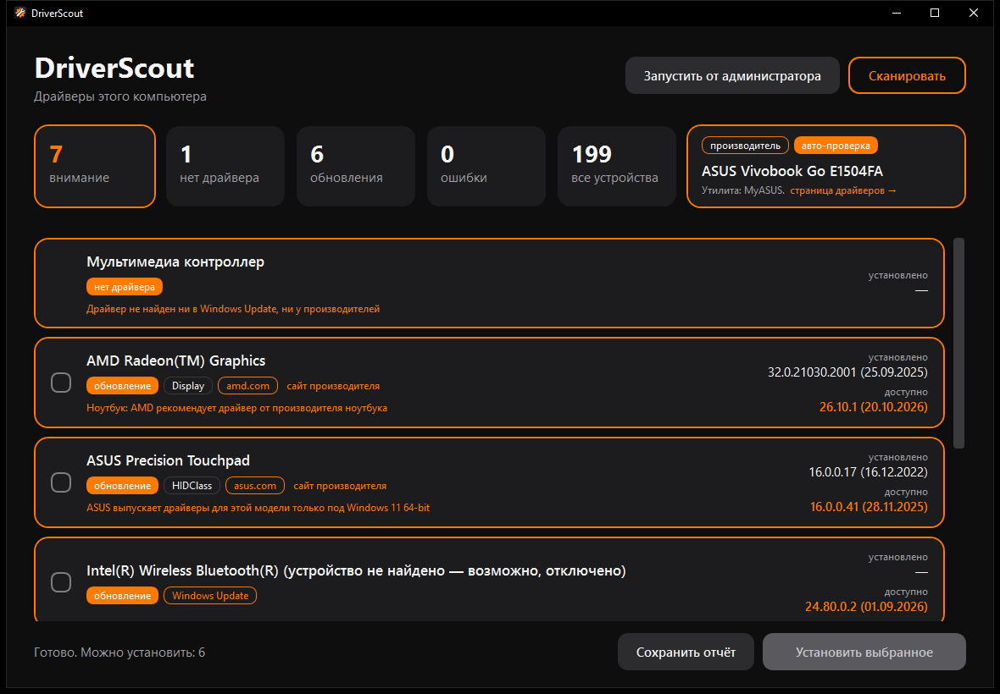

<p align="center">
  
</p>

<h1 align="center">DriverScout</h1>

<p align="center">
  Находит устройства без драйверов и устаревшие драйверы в Windows и ставит свежие версии —<br>
  только из официальных источников: Windows Update и сайтов производителей.
</p>

<p align="center">
  
  
  
  
  <a href="LICENSE"></a>
</p>

<p align="center">
  
</p>

## Возможности

- **Сканирование всех устройств** через WMI с разбивкой: *нет драйвера*, *есть обновление*, *ошибка*, *актуально*.
- **Windows Update** — драйверы, проверенные Microsoft, ставятся автоматически.
- **Официальные каталоги производителей ноутбуков** — ASUS, Lenovo, HP, Dell. Драйвер подбирается по Hardware ID и модели компьютера.
- **Видеокарты** — свежие драйверы NVIDIA и AMD с сайтов производителей.
- **Около 30 брендов ноутбуков** распознаются по SMBIOS: MSI, Acer, Gigabyte, Huawei, Honor, Xiaomi, Samsung, Razer, Fujitsu и другие. Для тех, кого нельзя проверить автоматически, — ссылка на страницу драйверов и фирменная утилита.
- **Безопасность установки**
  - точка восстановления Windows перед установкой;
  - проверка цифровой подписи производителя и SHA-256 каждого скачанного файла;
  - не предлагает «обновление», если установленная версия новее.
- **Отчёт** о состоянии драйверов в текстовый файл.

## Источники драйверов

| Источник | Как проверяется |
|---|---|
| Windows Update | Windows Update Agent API |
| ASUS | API поддержки ASUS, SHA-256 |
| Lenovo | каталог `download.lenovo.com` по типу машины, SHA-256 |
| HP | каталоги HP Image Assistant по SystemID платы, SHA-256 |
| Dell | `CatalogIndexPC` по SystemSKU, SHA-256 |
| NVIDIA | API GeForce Experience по Device ID |
| AMD | страницы продуктов amd.com |
| Intel, MSI, Acer, Gigabyte и др. | ссылка на страницу драйверов — их сайты не отдают список программам |

## Установка

Скачайте `DriverScout-Setup-<версия>.exe` из раздела **Releases** и запустите.
Отдельно ставить .NET не нужно — среда выполнения уже внутри.

Требования: Windows 10 или 11 x64, интернет. Для установки драйверов нужны права администратора — программа попросит их сама.

## Как пользоваться

1. Запустите DriverScout — сканирование начнётся само (около минуты).
2. Отметьте нужные обновления.
3. Нажмите **«Установить выбранное»**. Драйверы из Windows Update ставятся автоматически, установщики производителей открываются в обычном режиме.

Без окна, только отчёт:

```bash
DriverScout.exe --report report.txt
```

## Сборка из исходников

Нужны [.NET 8 SDK](https://dotnet.microsoft.com/download/dotnet/8.0) и, для установщика, [Inno Setup 6](https://jrsoftware.org/isinfo.php).

Запуск в режиме разработки:

```bash
dotnet run --project DriverScout
```

Установщик (публикация self-contained → подпись, если задан сертификат → упаковка):

```bash
powershell -ExecutionPolicy Bypass -File DriverScout/installer/build.ps1
```

Результат — `DriverScout/installer/Output/DriverScout-Setup-<версия>.exe`.

### Цифровая подпись

`build.ps1` подписывает программу, установщик и деинсталлятор, если задан сертификат для подписи кода:

| Переменная | Значение |
|---|---|
| `DRIVERSCOUT_CERT_PFX` + `DRIVERSCOUT_CERT_PASSWORD` | путь к `.pfx` и пароль |
| `DRIVERSCOUT_CERT_THUMBPRINT` | отпечаток сертификата в хранилище Windows (подходит для USB-токенов) |

Без сертификата собирается неподписанный установщик — Windows покажет «Неизвестный издатель».

## Структура

```
DriverScout/
├─ DeviceScanner.cs         сканирование устройств (WMI)
├─ WindowsUpdateSource.cs   поиск и установка через Windows Update
├─ VendorSources.cs         NVIDIA, AMD, Intel и общие помощники
├─ AsusSource.cs, LenovoSource.cs, HpSource.cs, DellSource.cs
├─ CabCatalog.cs            загрузка и распаковка .cab-каталогов
├─ VendorInstaller.cs       загрузка, проверка подписи и SHA-256, запуск установщика
├─ OemBrands.cs             справочник брендов ноутбуков
├─ ScanService.cs           сборка результатов и отчёт
├─ MainWindow.xaml, Theme.xaml, ThemedDialog.xaml   интерфейс
├─ installer/               Inno Setup, build.ps1, sign.ps1
└─ tools/IconGen.cs         генератор иконки
```

## Ограничения

- Сайты Intel, MSI, Acer и Gigabyte закрывают списки драйверов от программ — для них только ссылка.
- Установщики производителей запускаются в интерактивном режиме, а не тихо.
- Только Windows x64.

## Лицензия

[MIT](LICENSE) — можно свободно использовать, изменять и распространять с сохранением уведомления об авторских правах.
Драйверы скачиваются с сайтов производителей и распространяются на их условиях.
