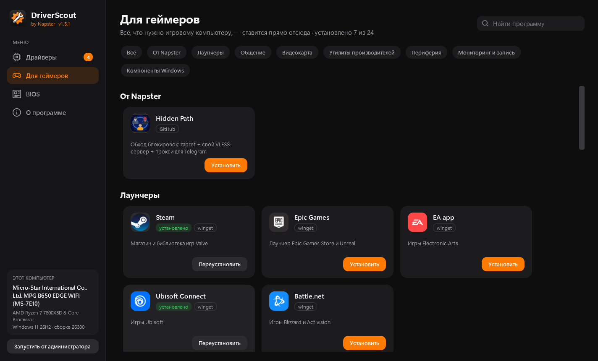
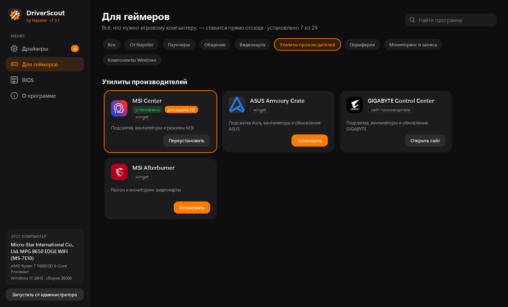
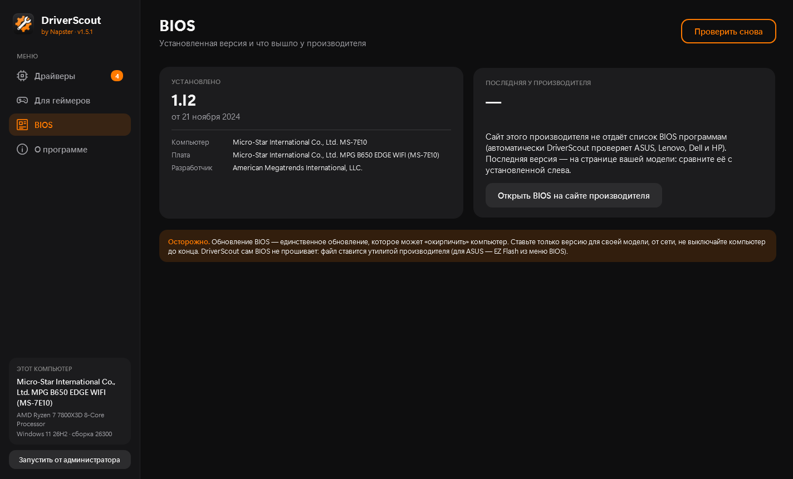
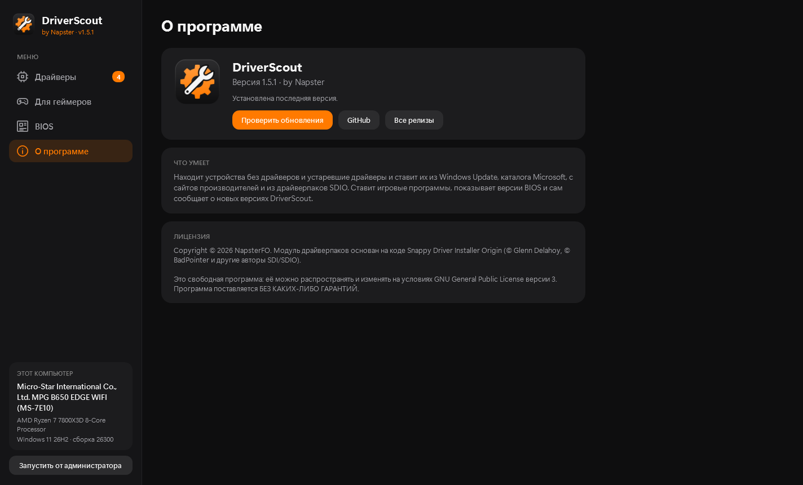

<p align="center">
  
</p>

<h1 align="center">DriverScout</h1>

<p align="center">
  Находит устройства без драйверов и устаревшие драйверы в Windows и ставит свежие версии —<br>
  из Windows Update, с сайтов производителей и, по желанию, из драйверпаков Snappy Driver Installer Origin.<br>
  А ещё ставит игровые программы в один клик, показывает версию BIOS и сам обновляется.
</p>

<p align="center">
  <a href="https://github.com/NapsterFO/DriverScout/releases/latest"></a>
  <a href="https://github.com/NapsterFO/DriverScout/releases"></a>
  
  
  
  
  <a href="LICENSE"></a>
</p>

<p align="center">
  <a href="https://github.com/NapsterFO/DriverScout/releases/latest"></a>
</p>

<p align="center">
  
</p>

## Скриншоты

<table>
  <tr>
    <td width="50%"><br><sub><b>Для геймеров</b> — лаунчеры, мессенджеры, драйверы видеокарты и утилиты в один клик</sub></td>
    <td width="50%"><br><sub><b>Утилиты производителей</b> — программа для вашей платы помечена «для вашего ПК»</sub></td>
  </tr>
  <tr>
    <td width="50%"><br><sub><b>BIOS</b> — установленная версия и что вышло у производителя</sub></td>
    <td width="50%"><br><sub><b>О программе</b> — проверка обновлений DriverScout</sub></td>
  </tr>
</table>

## Возможности

- **Сканирование всех устройств** через WMI с разбивкой: *нет драйвера*, *есть обновление*, *ошибка*, *актуально*.
- **Windows Update** — драйверы, проверенные Microsoft, ставятся автоматически.
- **Официальные каталоги производителей ноутбуков** — ASUS, Lenovo, HP, Dell (драйвер подбирается по Hardware ID и модели компьютера), Honor и Huawei (по модели и названию пакета).
- **Каталог Центра обновления Майкрософт** — для устройств без драйвера или с ошибкой DriverScout ищет драйвер по Hardware ID на catalog.update.microsoft.com. Там лежат драйверы, которые Windows Update сам не предлагает (Intel GPIO, HID Event Filter, Management Engine, Motorcomm Ethernet и т. п.). Файлы — .cab, подписанные Microsoft, проверяются по SHA-1 из каталога.
- **Видеокарты** — свежие драйверы NVIDIA и AMD с сайтов производителей.
- **Драйверпаки SDIO** (по кнопке «Драйверпаки SDIO») — для устройств, которым ничего не нашлось в официальных источниках. Алгоритм подбора перенесён из Snappy Driver Installer Origin: ранг совпадения Hardware ID, подпись каталога, декорации секций INF под версию Windows. По торренту скачиваются индексы (~25 МБ), а сами паки — только для выбранных драйверов.
- **Встроенные сетевые драйверы** — драйверпаки SDIO для проводных сетевых карт (Intel, Realtek, Killer/Atheros, Broadcom, Marvell и др.) уже лежат в установщике. Если у сетевой карты нет драйвера, DriverScout сразу после сканирования предложит поставить его — без интернета.
- **Около 30 брендов ноутбуков** распознаются по SMBIOS: MSI, Acer, Gigabyte, Huawei, Honor, Xiaomi, Samsung, Razer, Fujitsu и другие. Для тех, кого нельзя проверить автоматически, — ссылка на страницу драйверов и фирменная утилита.
- **Безопасность установки**
  - точка восстановления Windows перед установкой;
  - проверка цифровой подписи производителя и SHA-256 каждого скачанного файла;
  - не предлагает «обновление», если установленная версия новее.
- **Отчёт** о состоянии драйверов в текстовый файл.

### Для геймеров

24 программы для игрового компьютера ставятся прямо из DriverScout — без поиска установщиков по сайтам:

| Раздел | Программы |
|---|---|
| От Napster | [Hidden Path](https://github.com/NapsterFO/HiddenPath) |
| Лаунчеры | Steam, Epic Games, EA app, Ubisoft Connect, Battle.net |
| Общение | Discord, TeamSpeak 3 |
| Видеокарта | NVIDIA App, AMD Software: Adrenalin |
| Утилиты производителей | MSI Center, ASUS Armoury Crate, GIGABYTE Control Center, MSI Afterburner |
| Периферия | Logitech G HUB, Razer Synapse, SteelSeries GG, Corsair iCUE |
| Мониторинг и запись | HWiNFO, CPU-Z, GPU-Z, OBS Studio |
| Компоненты Windows | Visual C++ Redistributable, DirectX |

- Уже установленные программы отмечаются, а подходящие именно вашему ПК (по видеокарте и материнской плате) — помечены «для вашего ПК».
- Большинство программ ставится тихо через `winget` из официального репозитория Microsoft. NVIDIA App и AMD Adrenalin скачиваются с сайтов NVIDIA и AMD с проверкой цифровой подписи, Hidden Path — из GitHub-релиза с проверкой SHA-256.
- Установки идут по очереди, прогресс виден на карточке программы.

### BIOS

- Показывает установленную версию BIOS, дату и плату.
- Для **ASUS, Lenovo, Dell и HP** сам находит версии BIOS для вашей модели на сайте производителя и показывает, есть ли новее, с датой и ссылкой на скачивание.
- Для MSI, Gigabyte, ASRock и других — открывает страницу BIOS вашей модели на сайте производителя.
- DriverScout сам BIOS не прошивает: файл ставится утилитой производителя.

### Обновление программы

- При запуске DriverScout проверяет, не вышла ли новая версия на GitHub, и показывает карточку «Доступно обновление».
- Обновление в один клик: установщик скачивается, сверяется по SHA-256 из релиза и ставится поверх, после чего программа перезапускается.

## Источники драйверов

| Источник | Как проверяется |
|---|---|
| Windows Update | Windows Update Agent API |
| Каталог Microsoft | поиск `catalog.update.microsoft.com` по Hardware ID, фильтр по версии Windows, SHA-1 и подпись Microsoft у .cab, установка INF через `UpdateDriverForPlugAndPlayDevices` |
| ASUS | API поддержки ASUS, SHA-256 |
| Lenovo | каталог `download.lenovo.com` по типу машины, SHA-256 |
| HP | каталоги HP Image Assistant по SystemID платы, SHA-256 |
| Dell | `CatalogIndexPC` по SystemSKU, SHA-256 |
| Honor, Huawei | API сайта поддержки по коду модели; пакет подбирается по названию («IntelWLAN 22.190.0.4») — к установке не отмечается автоматически |
| NVIDIA | API GeForce Experience по Device ID |
| AMD | страницы продуктов amd.com |
| Драйверпаки SDIO | индексы `indexes/SDIO/*.bin` из раздачи `SDIO_Update.torrent`; установка через `UpdateDriverForPlugAndPlayDevices`, подпись проверяет Windows. Сторонняя сборка — к установке не отмечается автоматически |
| Intel, MSI, Acer, Gigabyte, Razer, Fujitsu и др. | ссылка на страницу драйверов — их сайты не отдают список программам или драйверы есть только в фирменной утилите |

## Установка

Скачайте `DriverScout-Setup-<версия>.exe` из раздела [**Releases**](https://github.com/NapsterFO/DriverScout/releases/latest) и запустите.
Отдельно ставить .NET не нужно — среда выполнения уже внутри. Дальше DriverScout обновляется сам.

Требования: Windows 10 или 11 x64, интернет (кроме встроенных сетевых драйверов). Для установки драйверов нужны права администратора — программа попросит их сама.

## Как пользоваться

1. Запустите DriverScout — сканирование начнётся само (около минуты).
2. Отметьте нужные обновления.
3. Нажмите **«Установить выбранное»**. Драйверы из Windows Update ставятся автоматически, установщики производителей открываются в обычном режиме.
4. На вкладке **«Для геймеров»** нажмите «Установить» у нужных программ, на вкладке **«BIOS»** — посмотрите, есть ли новая версия.

Без окна, только отчёт:

```bash
DriverScout.exe --report report.txt
```

## Сборка из исходников

Нужны [.NET 8 SDK](https://dotnet.microsoft.com/download/dotnet/8.0) и, для установщика, [Inno Setup 6](https://jrsoftware.org/isinfo.php).

Запуск в режиме разработки:

```bash
dotnet run --project DriverScout
```

Установщик (публикация self-contained → подпись, если задан сертификат → упаковка):

```bash
powershell -ExecutionPolicy Bypass -File DriverScout/installer/build.ps1
```

Результат — `DriverScout/installer/Output/DriverScout-Setup-<версия>.exe`.

При первой сборке скрипт скачивает торрентом SDIO сетевые драйверпаки (`DP_LAN_Intel`, `DP_LAN_Realtek-NT`,
`DP_LAN_Others`, ~220 МБ) в `installer/lan` — в репозиторий они не входят. Чтобы взять свежий выпуск паков,
удалите эту папку.

### Цифровая подпись

`build.ps1` подписывает программу, установщик и деинсталлятор, если задан сертификат для подписи кода:

| Переменная | Значение |
|---|---|
| `DRIVERSCOUT_CERT_PFX` + `DRIVERSCOUT_CERT_PASSWORD` | путь к `.pfx` и пароль |
| `DRIVERSCOUT_CERT_THUMBPRINT` | отпечаток сертификата в хранилище Windows (подходит для USB-токенов) |

Без сертификата собирается неподписанный установщик — Windows покажет «Неизвестный издатель».

## Структура

```
DriverScout/
├─ DeviceScanner.cs         сканирование устройств (WMI)
├─ WindowsUpdateSource.cs   поиск и установка через Windows Update
├─ VendorSources.cs         NVIDIA, AMD, Intel и общие помощники
├─ AsusSource.cs, LenovoSource.cs, HpSource.cs, DellSource.cs, HonorHuaweiSource.cs
├─ CabCatalog.cs            загрузка и распаковка .cab-каталогов
├─ VendorInstaller.cs       загрузка, проверка подписи и SHA-256, запуск установщика
├─ OemBrands.cs             справочник брендов ноутбуков
├─ ScanService.cs           сборка результатов и отчёт
├─ UpdateCatalog.cs         поиск в каталоге Центра обновления Майкрософт
├─ GameApps.cs              программы вкладки «Для геймеров» и их установка (winget, NVIDIA, AMD, GitHub)
├─ BiosService.cs           версия BIOS и выпуски ASUS, Lenovo, Dell, HP
├─ GitHubReleases.cs, AppUpdate.cs   релизы GitHub и самообновление DriverScout
├─ Sdi/                     драйверпаки SDIO: индексы, подбор, торрент, установка (порт кода SDIO)
├─ MainWindow.xaml, GamerPage.xaml, BiosPage.xaml, Theme.xaml, ThemedDialog.xaml   интерфейс
├─ Assets/apps/             иконки программ вкладки «Для геймеров»
├─ installer/               Inno Setup, build.ps1, sign.ps1
└─ tools/IconGen.cs         генератор иконки
```

## Ограничения

- Сайты Intel, MSI, Acer, Gigabyte, Razer и Fujitsu закрывают списки драйверов от программ — для них только ссылка.
- Honor и Huawei не публикуют Hardware ID и контрольные суммы: драйвер подбирается по названию, архив проверяется подписью установщика внутри или самой Windows (INF через `pnputil`).
- Драйверпаки SDIO — сторонняя сборка драйверов, а не сайты производителей. Загрузка идёт по торренту: первые минуты уходят на поиск пиров, паки весят от мегабайт до нескольких гигабайт. Индексировать собственные паки, как SDIO, DriverScout пока не умеет — только готовые индексы из раздачи.
- Из каталога Microsoft берётся только первая страница результатов (25 самых свежих записей): если все они для более новой Windows, старый драйвер не найдётся.
- Встроены только драйверы проводных сетевых карт; Wi-Fi-паки весят ~700 МБ и в установщик не входят.
- Установщики производителей запускаются в интерактивном режиме, а не тихо.
- BIOS автоматически проверяется только для ASUS, Lenovo, Dell и HP; для остальных — ссылка на страницу модели. Прошивать BIOS нужно утилитой производителя.
- GIGABYTE Control Center нет в `winget` — для него открывается сайт производителя.
- Только Windows x64.

## Лицензия

[GNU GPL v3](LICENSE) — можно свободно использовать, изменять и распространять; производные работы и распространяемые сборки
должны выходить под той же лицензией вместе с исходным кодом.

Copyright © 2026 NapsterFO. Модуль драйверпаков (`DriverScout/Sdi/`) — переработка кода
[Snappy Driver Installer Origin](https://www.glenn.delahoy.com/snappy-driver-installer-origin/)
(© Glenn Delahoy, © BadPointer и другие авторы SDI/SDIO, GPLv3).
Распаковка LZMA86/x86 BCJ — по алгоритмам LZMA SDK (общественное достояние).
Библиотеки: [SharpCompress](https://github.com/adamhathcock/sharpcompress) (MIT), [MonoTorrent](https://github.com/alanmcgovern/monotorrent) (MIT).

Драйверы скачиваются с сайтов производителей и из драйверпаков SDIO и распространяются на условиях их правообладателей.
